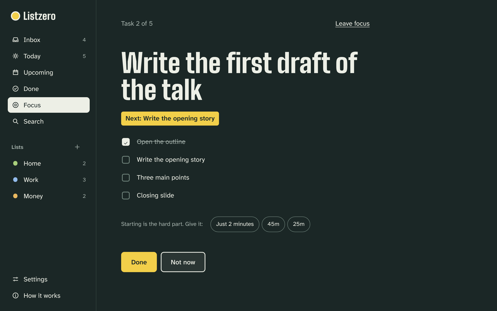

# Listzero

A free to-do list for busy minds. Type tasks the way you think, see one day at a time, and get today to zero.

**Live: [listzero.vercel.app](https://listzero.vercel.app)**. No sign-up. Your tasks stay in your browser.


## Why

Most to-do apps assume the hard part is organising. For a lot of people, and especially for people with ADHD, the
hard parts are getting the thought out of their head before it is gone, not drowning in a long list, and starting.
Listzero is built around those three moments.

| The moment | What Listzero does |
| --- | --- |
| "I need to write this down now" | One input on every view. It reads the day, time, list, priority and length out of the sentence. Paste a list and each line becomes a task. |
| "This list is too long to look at" | Today shows one number: how many tasks are between you and zero. Past a full day's worth, it offers to move the rest to tomorrow. |
| "I missed it yesterday" | Late tasks are "carried over", never red. One button moves them all, or drops their dates. |
| "I can't start" | Break a task into steps and the row shows only the next one. Focus puts a single task on the screen with a "just 2 minutes" timer. |
| "I got nothing done" | Done keeps what you finished, counted by day. |

<p>
  
  
</p>




## Features

- **Quick add that understands a sentence.** What it understood is shown as chips before you save. Close a chip and
  the words stay in the task name.

  | You type | It reads |
  | --- | --- |
  | `today` `tomorrow` `friday` `next week` `in 3 days` `12 dec` | the day |
  | `9am` `5:30pm` `17:00` `noon` | the time |
  | `every day` `every weekday` `every monday` `monthly` | a repeat |
  | `#work` | the list (a new name creates it) |
  | `p1` `p2` `p3` | the priority |
  | `15m` `1h` `1h 30m` | how long it takes |

- **Views:** Inbox, Today, Upcoming (grouped by day, with the planned time per day), your own lists, Done, Search.
- **Tasks:** steps, notes, day and time, repeats, priority, length, list. Changes save as you type.
- **Focus:** one task at a time, "Not now" to skip without losing it, a 2-minute start timer.
- **Undo** on finish, delete and every bulk move. Undo is withdrawn the moment anything else changes, so it can
  never roll back later work.
- **Light and dark themes**, applied before first paint. Follows the device by default.
- **Phone layout** with a bottom tab bar; installable; works offline.
- **Keyboard:** `Q` add, `/` search, `J` `K` move, `X` finish, `G` then `I` `T` `U` `D` `F` to jump.
- **Backups:** save everything to a JSON file and load it in another browser.
- **Accessible:** real buttons and dialogs, visible focus, WCAG AA contrast in both themes, reduced-motion support.
  Text is set in Atkinson Hyperlegible Next, a typeface designed to keep similar letters apart.

### What it does not do

No accounts, so no sync between devices. No reminders or notifications. No sharing. No streaks or points.

## How it is built

- **React 19 + TypeScript (strict) + Vite 8**, React Router for views. No UI library, no CSS framework: one
  hand-written stylesheet and a small set of inline SVG icons.
- **Local-first.** State is a single reducer (`src/lib/store.ts`); every change is written to `localStorage` and
  mirrored to other open tabs. There is no server and no database, so there is nothing to pay for and nothing to
  leak.
- **Nothing from outside is trusted.** Saved and imported data goes through one validator
  (`src/lib/backup.ts`) that checks and clamps every field. Unreadable saved data is set aside, not overwritten.
- **The parser is plain functions** (`src/lib/parse.ts`), with `now` passed in, so every rule is unit-tested
  against a fixed date.
- **Dates are local calendar days** (`YYYY-MM-DD` strings), never UTC instants, so a task due "today" does not
  move when the clock crosses midnight UTC.
- **Offline** through a service worker generated by `vite-plugin-pwa`.
- **Strict Content-Security-Policy** (`script-src 'self'`, no inline scripts or styles) and other security headers
  in `vercel.json`. The preview server sends the same headers, so the browser tests run under the real policy.

```
src/
  lib/         parser, dates, reducer and views, backup validation (all pure, all unit-tested)
  state/       the store provider, theme and URL helpers
  components/  quick add, task row, task sheet, dialogs, shell
  views/       Today, Inbox, Upcoming, lists, Done, Focus, Search, Settings, About
  styles/      app.css
tests/e2e/     Playwright tests
```

## Run it

Needs Node 22 or newer.

```bash
npm install
npm run dev        # http://localhost:5173
```

```bash
npm run lint
npm run typecheck
npm test           # unit tests (Vitest)
npm run build
npm run test:e2e   # browser tests (Playwright); run `npx playwright install chromium` once first
```

## Tests

- **Unit (Vitest):** the parser, date maths (month ends, leap days, repeats), the reducer and views, and backup
  validation.
- **Browser (Playwright), on a desktop and a phone profile:** every flow above, plus axe accessibility checks on
  every view in both themes, a no-sideways-scroll check at 360px, the Content-Security-Policy, the offline path,
  and two-tab sync.

CI runs all of it on every pull request.

## Where it came from

Listzero replaces five earlier to-do experiments of mine: three 2021 React tutorials (Create React App, Material UI,
Redux), and ZapList (2025), a React + Vite front end with an Express + PostgreSQL API. ZapList's history is the
history of this repository. The other four are kept, with their commits, on the
[`legacy`](https://github.com/Shahryartariq/listzero/tree/legacy) branch.

## License

[MIT](LICENSE). Fonts are under the SIL Open Font License; see [`src/assets/fonts`](src/assets/fonts/README.md).
