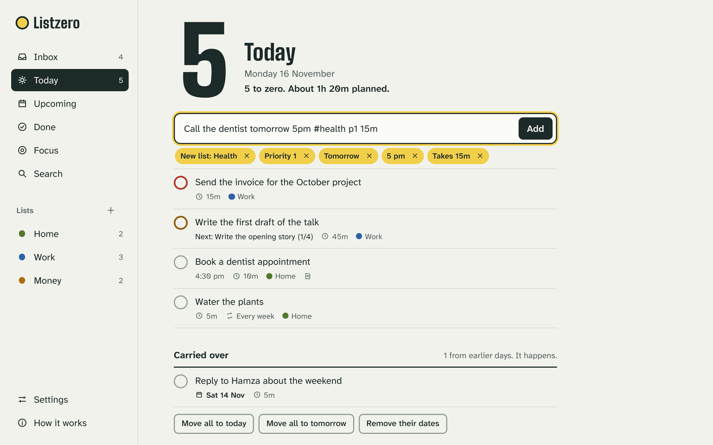
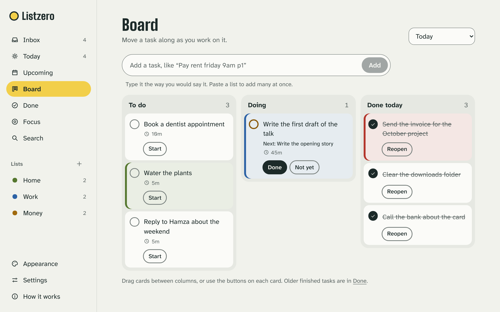
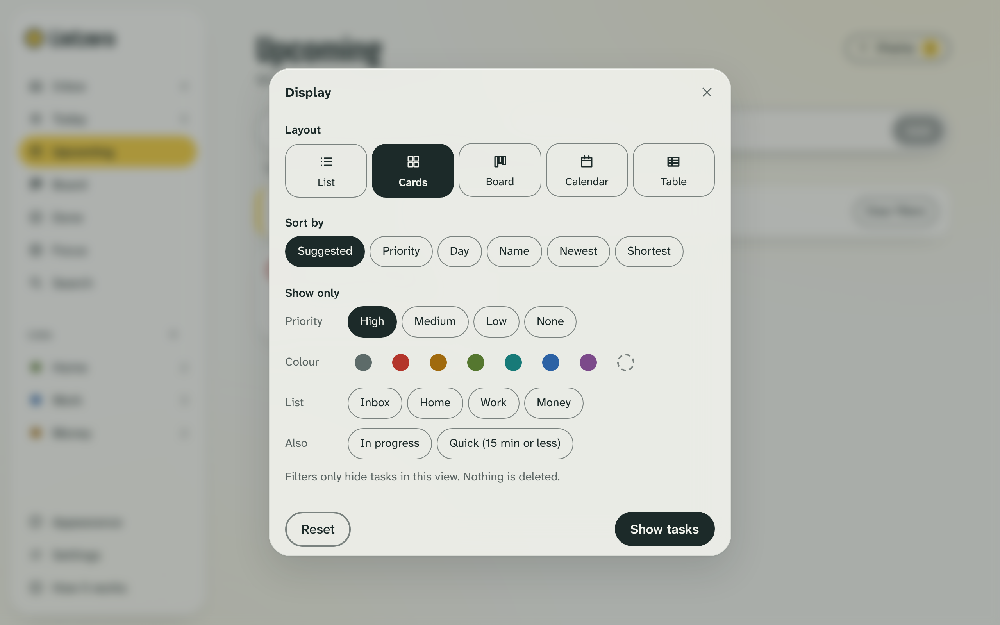
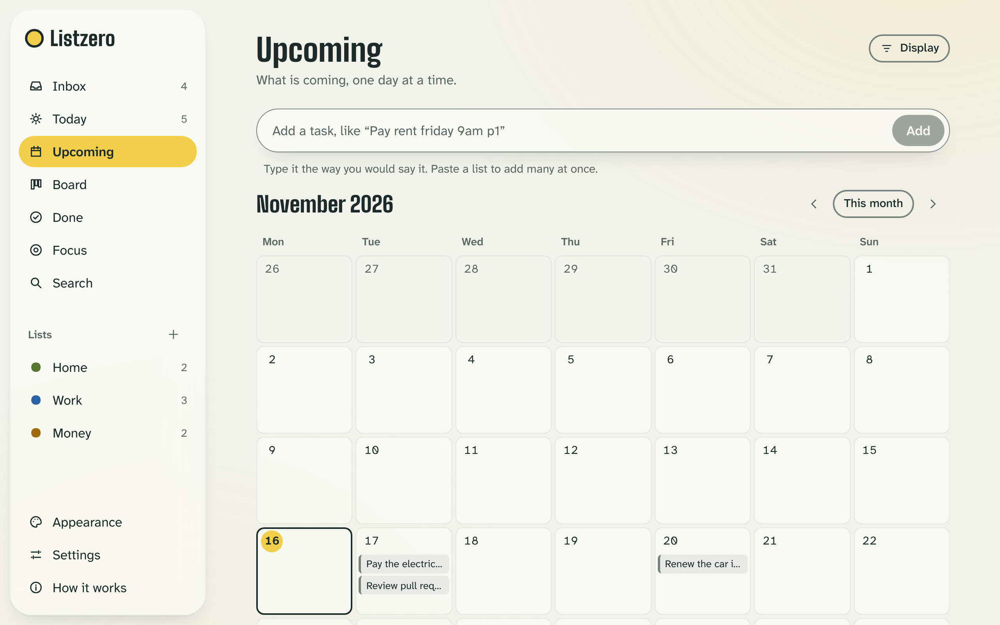
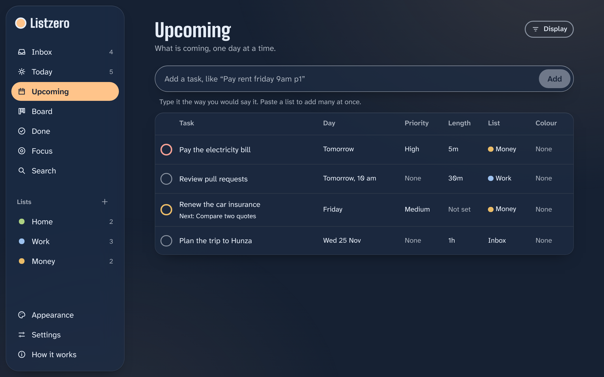
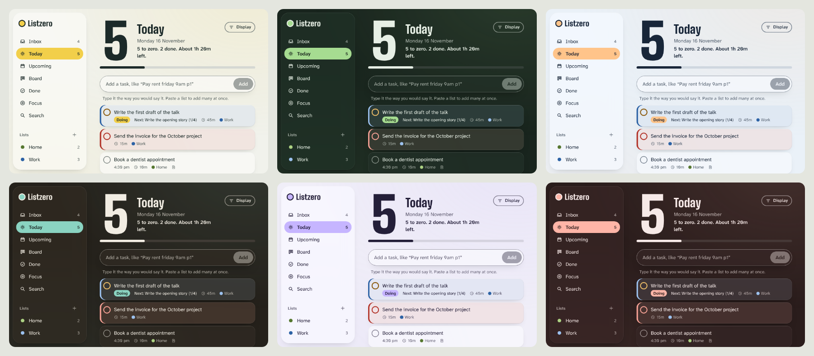
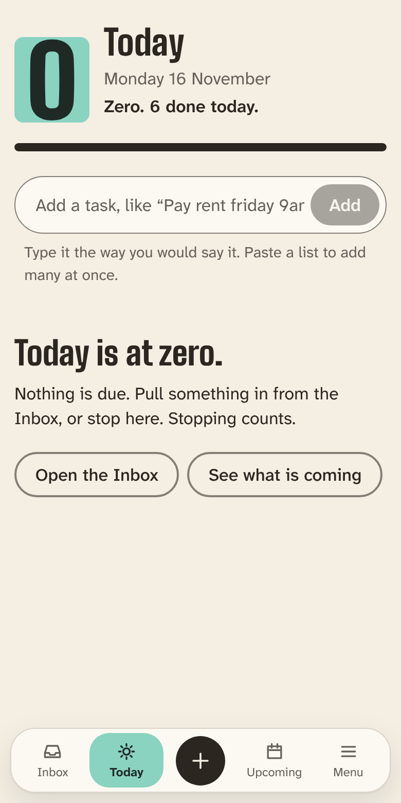
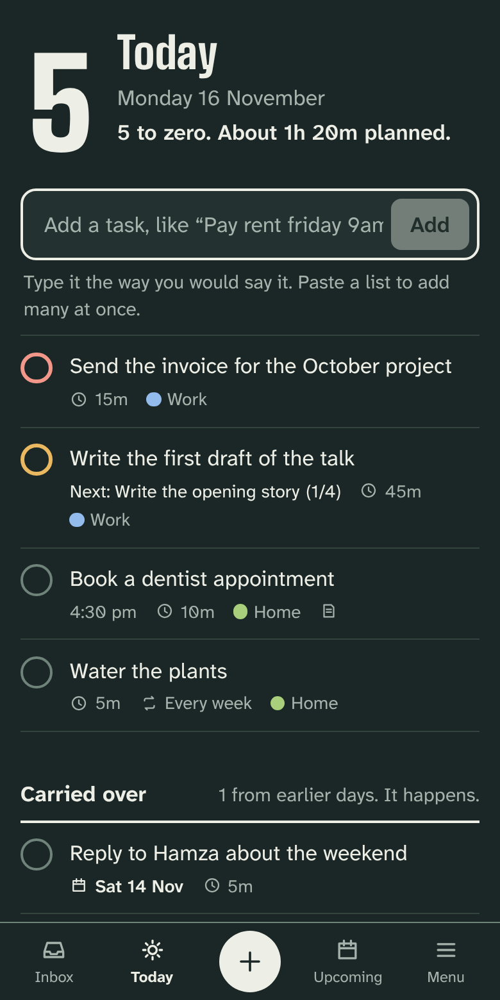
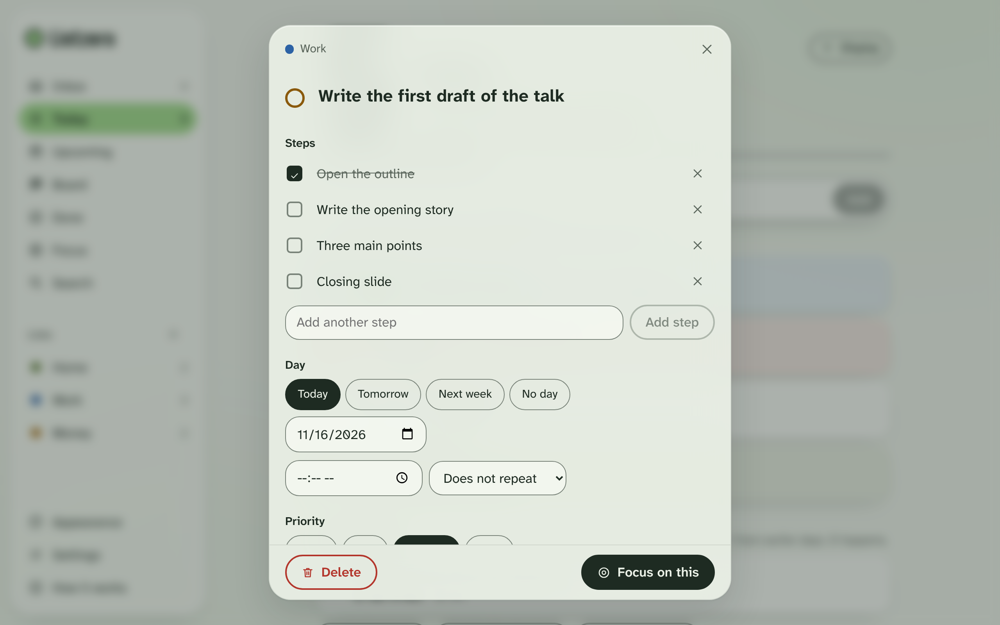

# Listzero

A free to-do list for busy minds. Type tasks the way you think, see one day at a time, and get today to zero.

**Live: [listzero.vercel.app](https://listzero.vercel.app)**. No sign-up needed: your tasks stay in your browser.
Sign in, if you want to, to keep them the same on every device.



## Why

Most to-do apps assume the hard part is organising. For a lot of people, and especially for people with ADHD, the
hard parts are getting the thought out of their head before it is gone, not drowning in a long list, and starting.
Listzero is built around those three moments.

| The moment | What Listzero does |
| --- | --- |
| "I need to write this down now" | One input on every view. It reads the day, time, list, priority and length out of the sentence. Paste a list and each line becomes a task. |
| "This list is too long to look at" | Today shows one number: how many tasks are between you and zero. Past a full day's worth, it offers to move the rest to tomorrow. |
| "I missed it yesterday" | Late tasks are "carried over", never red. One button moves them all, or drops their dates. |
| "I can't start" | Break a task into steps and the row shows only the next one. Focus puts a single task on the screen with a "just 2 minutes" timer. The board's Doing column keeps what is in progress small and visible. |
| "I got nothing done" | Done keeps what you finished, counted by day. |





<p>
  
  
</p>



<p>
  
  
</p>




## Features

- **Quick add that understands a sentence.** What it understood is shown as chips before you save. Close a chip and
  the words stay in the task name.

  | You type | It reads |
  | --- | --- |
  | `today` `tomorrow` `friday` `next week` `in 3 days` `12 dec` | the day |
  | `9am` `5:30pm` `17:00` `noon` | the time |
  | `every day` `every weekday` `every monday` `monthly` | a repeat |
  | `#work` | the list (a new name creates it) |
  | `p1` `p2` `p3` | the priority |
  | `15m` `1h` `1h 30m` | how long it takes |

- **Views:** Inbox, Today, Upcoming (grouped by day, with the planned time per day), Board, your own lists, Done,
  Search.
- **Board:** a Kanban view with To do, Doing and Done today. Move cards with the buttons on each card or by
  dragging; show today's tasks, the Inbox, one list or everything. More than three in Doing gets a gentle note,
  never a block. On a phone it shows one column at a time.
- **Display:** a button on Inbox, Today, Upcoming and every list. It changes the layout (List, Cards, Board,
  Calendar or Table), the sort order (suggested, priority, day, name, newest, shortest) and which tasks show
  (by priority, colour, list, in progress, or 15 minutes or less). Each view remembers its own choice. A note says
  how many tasks a filter hides, and Reset puts the view back. In the calendar, drag a task to another day; in the
  table, click a heading to sort.
- **Tasks:** steps, notes, day and time, repeats, priority, length, list, and a colour of your choice that tints
  the task everywhere. Changes save as you type.
- **Focus:** one task at a time, "Not now" to skip without losing it, a 2-minute start timer.
- **Undo** on finish, delete and every bulk move. Undo is withdrawn the moment anything else changes, so it can
  never roll back later work.
- **Six calm colour palettes** (Chalk, Sage, Sky, Sand, Lilac, Rose), each with a light and a dark side. They are
  muted on purpose: no pure white, no pure black, one soft accent each. Switching cross-fades the whole page, and
  the saved look is applied before first paint. A unit test checks every palette for text contrast (AA or better).
- **Soft glass surfaces:** rounded tiles that let a little of the page show through, a floating sidebar, and
  sheets that blur what is behind them. The effect is kept weak so text contrast holds (unit-tested at the
  strongest point), and it turns solid for people who ask their system for more contrast or less transparency.
  On wide screens the content sits in the middle; cards, board, calendar and table use the full width.
- **Less to look at when you want it:** a larger text size, rows that show only the task name, and an option to
  turn the small animations off.
- **Today's progress** as a bar that fills as you finish things.
- **Phone layout** with a bottom tab bar; installable; works offline.
- **Keyboard:** `Q` add, `/` search, `J` `K` move, `X` finish, `G` then `I` `T` `U` `B` `D` `F` `S` to jump.
- **Backups:** save everything to a JSON file and load it in another browser.
- **Honest about storage:** a warning when the browser will not keep data, a different one when it has run out
  of room, and if saved data ever cannot be read, a copy is kept and offered as a download instead of being lost.
- **Accessible:** real buttons and dialogs, visible focus, WCAG AA contrast in every palette, reduced-motion support.
  Text is set in Atkinson Hyperlegible Next, a typeface designed to keep similar letters apart.

### What it does not do

No reminders or notifications. No sharing. No streaks or points.

## Accounts and sync (optional)

Everything above works without an account. An account adds one thing: your tasks and lists are the same on every
device you sign in on.

- **Ways in:** email and password, username and password, Google, or a passkey (fingerprint, face or device PIN).
- **Email confirmation** before the first sign-in, **password reset** by email, and a check that refuses passwords
  known from data leaks.
- **Two-factor codes** from an authenticator app, with ten one-time backup codes.
- **An Account page:** sync status, profile, password, two-factor, passkeys, Google, every device you are signed in
  on (sign any of them out), sign out, and delete the account (confirmed by email).
- **Sync that respects what is already here.** Signing in on a device with tasks adds them to the account. Changes
  made offline are sent later. A browser holding someone else's tasks asks before mixing them. Signing out offers
  to keep the tasks in the browser or remove them. Appearance and other settings stay per device.
- **An admin page** for the people listed in `ADMIN_EMAILS`: see who has an account, suspend or lift a suspension,
  sign someone out everywhere, change roles, delete an account. Admins never see anyone's tasks and cannot sign in
  as someone else.

## How it is built

- **React 19 + TypeScript (strict) + Vite 8**, React Router for views. No UI library, no CSS framework:
  hand-written CSS and a small set of inline SVG icons.
- **Themes are five colours each.** A palette names its paper, surface, ink, accent and accent text
  (`src/styles/themes.css`); muted text and outlines are mixed from ink and paper with `color-mix()`, so every
  palette gets the same contrast steps. Theme changes use the View Transitions API.
- **Local-first.** State is a single reducer (`src/lib/store.ts`); every change is written to `localStorage` and
  mirrored to other open tabs. The app never waits for a server: without an account there is none involved.
- **Accounts are a small API beside the site** (`server/`), one Vercel Function at `/api`:
  [Better Auth](https://better-auth.com) for sign-in, Drizzle ORM on Postgres (Neon) for storage, nodemailer for
  email. The whole API is one function from `Request` to `Response` (`server/app.ts`), so tests drive it directly
  against an in-memory Postgres (PGlite). When the database, secret or address is missing, `/api/config` says so
  and the app shows no sign-in at all.
- **Sync is per item, last change wins.** Every saved task or list gets a number from a per-account counter; a
  device sends what changed since it last synced and receives everything numbered after its cursor
  (`server/sync.ts`, `src/sync/`). The server checks each item with the same validator as backup files and caps
  the size of an account.
- **Nothing from outside is trusted.** Saved and imported data goes through one validator
  (`src/lib/backup.ts`) that checks and clamps every field. Unreadable saved data is set aside, not overwritten,
  and the app says so.
- **The parser is plain functions** (`src/lib/parse.ts`), with `now` passed in, so every rule is unit-tested
  against a fixed date.
- **Dates are local calendar days** (`YYYY-MM-DD` strings), never UTC instants, so a task due "today" does not
  move when the clock crosses midnight UTC.
- **Offline** through a service worker generated by `vite-plugin-pwa`.
- **Fast first load.** The script that sets the saved look runs inline before the first paint, the service
  worker registers after load, and screens most visits never open (Settings, Board, Focus, the calendar and table)
  are separate downloads fetched in idle time. Lighthouse on a phone profile: 95 to 99 performance, 100 accessibility,
  100 best practices, 100 SEO.
- **Strict Content-Security-Policy** and other security headers in `vercel.json`: scripts and styles only from the
  site itself, the one inline script allowed by its hash, and the analytics hosts by name. The preview server sends
  the same headers, so the browser tests run under the real policy. A unit test fails if the script and its hash,
  or the app's routes and the host's rewrites, drift apart. See [SECURITY.md](SECURITY.md).
- **A single-page app that still behaves like a site.** A build step (`scripts/pages.mjs`) writes a real page head
  for `/about`, a `404.html` so unknown addresses answer 404 instead of 200, and a dated sitemap. The app's own
  screens (Inbox, Settings and the rest) mark themselves `noindex`; only the home page and "How it works" ask to
  be indexed.

```
src/
  lib/         parser, dates, reducer and views, backup validation (all pure, all unit-tested)
  state/       the store provider, theme and URL helpers
  components/  quick add, task row, task sheet, dialogs, shell
  views/       Today, Inbox, Upcoming, lists, Done, Focus, Search, Settings, About
  styles/      themes.css (palettes), app.css (layout and components)
  account/     the auth client, sign-in form parts, the sync runner and sign-out choices
  sync/        working out what changed, applying the account's changes, the sync loop
server/        the API: auth, sync, email, database schema (all tested in-process)
api/           the Vercel Function entry; the bundled server is built into it
drizzle/       database migrations
tests/e2e/     Playwright tests
scripts/       pages.mjs: the extra HTML files written after the build; build-api.mjs, migrate.mjs
```

## Privacy

Without an account, your tasks never leave your browser.

With an account, the server stores your email, name, username, a hash of your password (never the password), your
two-factor secret and passkeys, and your tasks and lists. They are used to sign you in and to sync, nothing else.
Deleting the account deletes all of it.

The public site at listzero.vercel.app counts visits with Google Analytics so I can see whether anyone uses it.
It records which kind of screen was opened ("Today", "a list") and the usual browser details Google collects. Task
names, notes, list names, ids and search words are never sent: addresses and page titles are replaced with fixed
ones first (`src/lib/analytics.ts`, covered by unit and browser tests). Advertising features are off. It can be
turned off in Settings, it is off when the browser sends Do Not Track or Global Privacy Control, and it never runs
on a local copy, a preview, or a copy you host yourself.

## Run it

Needs Node 22 or newer.

```bash
npm install
npm run dev        # http://localhost:5173
npm run api        # optional: accounts and sync on http://localhost:8787, in-memory database
```

`npm run api` prints the emails it would send (confirmation links and so on) instead of sending them. Sign up with
`admin@listzero.test` to try the admin page.

### Turning accounts on for a deployment

1. Connect a Neon Postgres database to the Vercel project (this sets `DATABASE_URL`).
2. Add the variables in [.env.example](.env.example) under Project → Settings → Environment Variables.
3. Redeploy. The build applies database migrations on production deploys.

```bash
npm run lint
npm run typecheck
npm test           # unit tests (Vitest)
npm run build      # type-checks, builds, then writes about/index.html, 404.html and sitemap.xml
npm run test:e2e   # browser tests (Playwright); run `npx playwright install chromium` once first
```

## Tests

- **API (Vitest, in-process with PGlite):** sign-up, email confirmation, sign-in by email and username, password
  reset, rate limits, admin rights (and that impersonation is refused), sync between two devices, offline batches,
  quotas, isolation between accounts, and account deletion.
- **Unit (Vitest):** the sync engine, the parser, date maths (month ends, leap days, repeats), the reducer and views, backup
  validation, display filters and sorting, the contrast of every palette in both modes, what analytics may send,
  and the site files (security policy, rewrites, page head, sitemap).
- **Browser (Playwright), on a desktop and a phone profile:** every flow above, plus axe accessibility checks on
  every view, layout and palette, a no-sideways-scroll check at 360px, the Content-Security-Policy, the offline path,
  two-tab sync, which screens ask to be indexed, and that visit counting sends nothing a visitor typed. Accounts are
  tested end to end against the real API: sign-up with the emailed link, username sign-in, password reset,
  two-factor with a computed code and a backup code, a passkey through a virtual authenticator, sync between two
  browsers, offline catch-up, both ways of signing out, a shared browser, signing other devices out, deleting the
  account, the admin page, and a copy with accounts turned off.

CI runs all of it on every pull request, with CodeQL scanning the code. Releases are made by the `Release`
workflow from the version in `package.json` and its section of [CHANGELOG.md](CHANGELOG.md).

## Where it came from

Listzero replaces five earlier to-do experiments of mine: three 2021 React tutorials (Create React App, Material UI,
Redux), and ZapList (2025), a React + Vite front end with an Express + PostgreSQL API. ZapList's history is the
history of this repository. The other four are kept, with their commits, on the
[`legacy`](https://github.com/Shahryartariq/listzero/tree/legacy) branch.

## License

[MIT](LICENSE). Fonts are under the SIL Open Font License; see [`src/assets/fonts`](src/assets/fonts/README.md).
